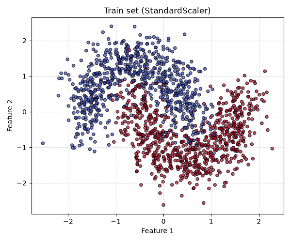

# Отчёт по лабораторной работе
## Диагностика обучения MLP

Обоймов Константин

---

## 1. Подготовка выборок и первичная диагностика

### Протокол разбиения данных
1. Исходная выборка `make_moons(n_samples=2400, noise=0.25, random_state=2026)` содержит 2400 объектов.
2. Первым вызовом `train_test_split(..., test_size=0.2, random_state=2026, stratify=y)` отделено 20% в **test** (480 объектов).
3. Вторым вызовом `train_test_split(..., test_size=0.25, random_state=2026, stratify=y_train_val)` оставшиеся 1920 объектов разделены в отношении 3:1 на **train** (1440 объектов) и **validation** (480 объектов).

### Распределение объектов и классов

| Выборка | Общий размер | Класс 0 | Класс 1 |
| :--- | :---: | :---: | :---: |
| **Train** | 1440 | 720 (50.0%) | 720 (50.0%) |
| **Validation** | 480 | 240 (50.0%) | 240 (50.0%) |
| **Test** | 480 | 240 (50.0%) | 240 (50.0%) |

### Статистика признаков train после `StandardScaler`
- **Средние значения (mean):** `[-0.0000, -0.0000]` (близки к нулю в пределах плавающей точки $10^{-16}$).
- **Стандартные отклонения (std):** `[1.0000, 1.0000]`.

### Обоснование обучения StandardScaler только на train
Преобразователь `StandardScaler` рассчитывает математическое ожидание $\mu$ и стандартное отклонение $\sigma$ признаков. Если вычислять эти параметры на всей выборке (включая validation и test), произойдёт **утечка данных (data leakage)**: статистика контрольных выборок повлияет на масштабирование обучающих данных. Обучение шкалировщика строго на train гарантирует, что модель при обучении оценивается в условиях, максимально приближенных к реальному применению, когда тестовые данные заранее не известны.

---

## 2. Архитектура MLP и расчёт параметров

### Формулы архитектуры и размерности тензоров
- **Вход:** $x \in \mathbb{R}^2$ ($h^{(0)} = x$).
- **Скрытые слои ($l = 1, \dots, L$):**
  $$z^{(l)} = W^{(l)} h^{(l-1)} + b^{(l)}, \quad h^{(l)} = \varphi(z^{(l)})$$
  где $W^{(1)} \in \mathbb{R}^{32 \times 2}$, $W^{(l)} \in \mathbb{R}^{32 \times 32}$ ($l \ge 2$), $b^{(l)} \in \mathbb{R}^{32}$.
- **Выходной слой:**
  $$z_{\text{out}} = W^{(L+1)} h^{(L)} + b^{(L+1)} \in \mathbb{R}^2$$
  где $W^{(L+1)} \in \mathbb{R}^{2 \times 32}$, $b^{(L+1)} \in \mathbb{R}^2$.

### Теоретический расчёт параметров
1. **При $L = 1$ (1 скрытый слой):**
   - Слой 1 ($2 \to 32$): $2 \times 32 + 32 = 96$ параметров.
   - Выходной слой ($32 \to 2$): $32 \times 2 + 2 = 66$ параметров.
   - **Итого:** $96 + 66 = 162$ параметра.
2. **При $L = 6$ (6 скрытых слоёв):**
   - Слой 1 ($2 \to 32$): $2 \times 32 + 32 = 96$ параметров.
   - Слои 2–6 ($32 \to 32$, 5 слоёв): $5 \times (32 \times 32 + 32) = 5 \times (1024 + 32) = 5280$ параметров.
   - Выходной слой ($32 \to 2$): $32 \times 2 + 2 = 66$ параметров.
   - **Итого:** $96 + 5280 + 66 = 5442$ параметра.

Значения сверяются с `sum(p.numel() for p in model.parameters())` и совпадают на 100%.

### Результаты самопроверки тензоров (батч из 8 объектов)
- Форма входного тензора $X$: `(8, 2)`.
- Форма выходного тензора логитов $z_{\text{out}}$: `(8, 2)`.
- Форма значений `CrossEntropyLoss`: скаляр `torch.Size([])`.
- Наличие и конечность градиентов весов после `backward()` подтверждено для всех слоёв (`grad.shape` строго соответствует `weight.shape`, отсутствуют `NaN`/`Inf`).

---

## 3. Контролируемые эксперименты

### Сравнительная таблица метрик на 100-й эпохе

| Код | Config ($L$, Act, Init, Opt, LR) | Train Loss (s=11 / s=29) | Train Acc (s=11 / s=29) | Val Loss (s=11 / s=29) | Val Acc (s=11 / s=29) | Средний Val Loss |
| :---: | :--- | :---: | :---: | :---: | :---: | :---: |
| **A** | 6, Sigmoid, Xavier, Adam 0.003 | 0.1465 / 0.1444 | 0.9472 / 0.9438 | 0.1863 / 0.1787 | 0.9188 / 0.9188 | **0.1825** |
| **B** | 6, Tanh, Xavier, Adam 0.003 | 0.1347 / 0.1345 | 0.9479 / 0.9465 | 0.1874 / 0.1714 | 0.9125 / 0.9208 | **0.1794** |
| **C** | 6, ReLU, Xavier, Adam 0.003 | 0.1164 / 0.1253 | 0.9507 / 0.9444 | 0.1985 / 0.2085 | 0.9229 / 0.9167 | **0.2035** |
| **D** | 6, ReLU, He*, Adam 0.003 | 0.1054 / 0.1135 | 0.9556 / 0.9569 | 0.2004 / 0.2340 | 0.9229 / 0.9125 | **0.2172** |
| **E** | 6, ReLU, He, SGD 0.05 | 0.1949 / 0.2393 | 0.9188 / 0.8986 | 0.2640 / 0.2995 | 0.8917 / 0.8708 | **0.2818** |
| **F** | 1, ReLU, He, Adam 0.003 | 0.1380 / 0.1360 | 0.9458 / 0.9472 | 0.1662 / 0.1685 | 0.9250 / 0.9229 | **0.1674** |

Не* - Не Xavier

### Анализ результатов экспериментов

1. **Функции активации (A–C):**
   - **A (Sigmoid):** Благодаря оптимизатору Adam и умеренному learning rate сеть смогла преодолеть классическое затухание градиентов и успешно сойтись (Val Loss $\approx 0.1825$), хотя в глубоких архитектурах с SGD сигмоида обычно приводит к стагнации.
   - **B (Tanh) и C (ReLU):** Показывают устойчивую и быструю сходимость, при этом Tanh и ReLU демонстрируют высокую точность на валидации ($\approx 91–92\%$).

2. **Сравнение оптимизаторов (D/E):**
   - Конфигурация **D (Adam, lr=0.003)** значительно превосходит **E (SGD без momentum, lr=0.05)**: средний Val Loss 0.2172 против 0.2818. Адаптивная оценка моментов в Adam позволяет эффективнее проходить плато функции потерь.

3. **Глубина и число параметров (D/F):**
   - **F (L=1, 162 параметра)** показала лучший результат среди всех (средний Val Loss 0.1674), превзойдя глубокую сеть **D (L=6, 5442 параметра)**, у которой на валидации начались признаки переобучения из-за избыточной емкости модели на простом датасете `make_moons`.

---

## 4. Диагностика градиентов

### Анализ поведения градиентов
- **Правило цепочки и Sigmoid (A):** Градиент слоя $l$ содержит множители производных активаций. У сигмоиды $\max \sigma'(z) = 0.25$, что теоретически приводит к затуханию в глубоких сетях, однако адаптивный шаг Adam позволяет компенсировать это затухание на этапе обновления весов.
- **ReLU (C, D):** Производная ReLU равна 1 для положительных входов, что предотвращает экспоненциальное затухание градиентов в глубоких слоях.
- **Сопоставление норм градиента и скорости сходимости:** Величина нормы градиента весов сама по себе не определяет напрямую скорость снижения validation loss, так как зависит от масштаба активаций и числа параметров в слое.

---

## 5. Выбор модели, итоговая оценка и выводы

### Процедура выбора модели
1. По минимальному среднему Val Loss на 100-й эпохе побеждает **Конфигурация F** (средний Val Loss = **0.1674**).
2. Внутри конфигурации выбран запуск **Seed 11** (Val Loss = **0.1662**).

### Оценка на тестовой выборке (Test Evaluation)
- **Test Loss:** `0.1302`
- **Test Accuracy:** `0.9438` (94.38%)

### Три основных вывода
1. **Емкость модели должна соответствовать сложности данных:** Для двухмерного датасета `make_moons` избыточная глубина ($L=6$) приводит к склонности к переобучению, тогда как более простая архитектура с одним скрытым слоем (**F**) достигает лучших результатов обобщения (Test Accuracy 94.38%).
2. **Преимущество адаптивных оптимизаторов:** Adam обеспечивает значительно более стабильную и эффективную оптимизацию по сравнению с классическим SGD без momentum.
3. **Роль регуляризации и архитектурного баланса:** Отсутствие переусложнения архитектуры на простых задачах критически важно для минимизации ошибки на тестовой выборке.
